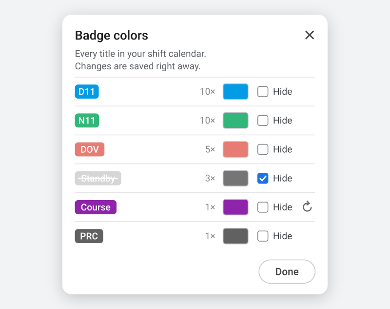

# Google Calendar – Shift Badges

A userscript for shift workers. It shows the title of each event in your shift calendar – for example `D11`, `Night` or `Vacation` – as a small colored badge in the top-right corner of the day in Google Calendar's **month view**, similar to the corner info in the aCalendar Android app.

The badges come from your shift calendar's iCal feed. The calendar's normal event bars are not touched: tick or untick the shift calendar in Google Calendar's left sidebar, whichever you prefer.

## Install

1. Install [Tampermonkey](https://www.tampermonkey.net/) (Chrome, Edge, Firefox) or Violentmonkey.
2. Chrome/Edge only: open `chrome://extensions`, click **Details** on Tampermonkey and switch on **Allow User Scripts**.
3. Click **[install the script](https://raw.githubusercontent.com/mikulik86/gcal-shift-badges/main/gcal-shift-badges.user.js)** and confirm in Tampermonkey.

## Set up

1. Put each shift into a dedicated Google calendar as an all-day event. Its title is what the badge shows – any text works, short titles fit best.
2. Google Calendar → Settings → that calendar → *Integrate calendar* → copy the **Secret address in iCal format**.
3. Open Google Calendar in month view, click the Tampermonkey icon → **Shift badges: set iCal address** → paste → OK.

To remove the badges, set an empty address. The secret address gives read access to that calendar – don't share it.

Edit your shifts as usual (in the web calendar or any app synced with it). The script reloads the feed every 30 minutes, or right away via **Shift badges: reload now**. Google can take a while to publish changes in the iCal feed.

## Colors

Tampermonkey icon → **Shift badges: colors** lists every title from your shift calendar with how often it occurs. Pick a color, tick **Hide** to leave a title out, or use ↺ to go back to the starting color. Changes show on the calendar right away.

Until you pick a color, titles are grey, except for the starting colors in the `CONFIG` block at the top of the script (`startColors`, e.g. D11 blue, N11 green). The badge text turns dark on light colors automatically.

The iCal address and your colors are stored by Tampermonkey, so script updates keep them. They are stored per browser; on another computer set them again or use Tampermonkey's sync. Edits in `CONFIG` itself are replaced when the script updates.

## Troubleshooting

Tampermonkey menu → **Shift badges: diagnose** shows whether an address is set, the feed status, and what the script found on the page. Please include that output when opening an issue.

## Limitations

- Month view in a desktop browser only; the Google Calendar mobile apps are not affected.
- Google Calendar's page structure is undocumented and changes from time to time, which can break the script until it is adjusted.
- Recurring events (`RRULE`) in the feed are not expanded; one event per shift works fine.

Pictures are illustrations with sample data.

## License

MIT
