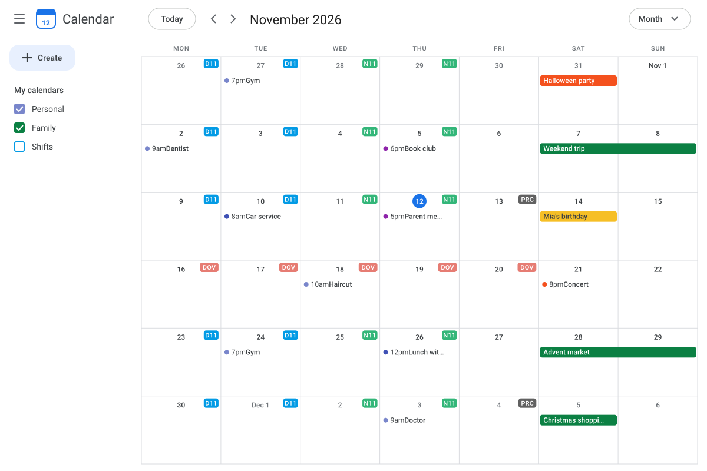
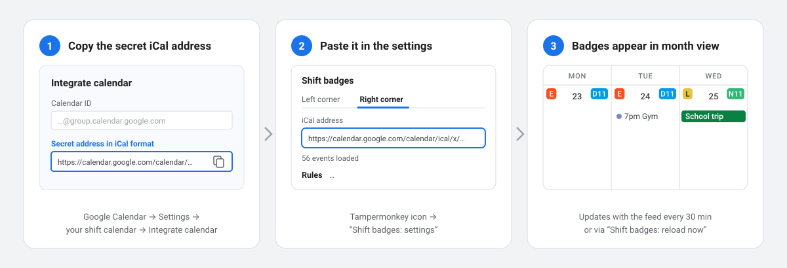
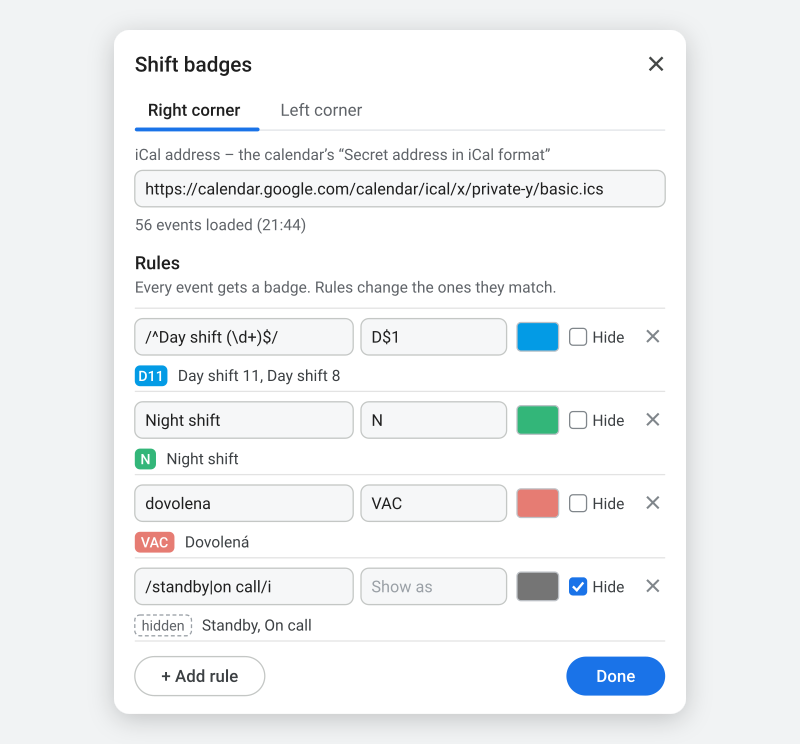

# Google Calendar – Shift Badges

A userscript for shift workers. It shows the events of up to two Google calendars as small colored badges in the top corners of each day in Google Calendar's **month view** – for example your shifts on the right and your partner's on the left – similar to the corner info in the aCalendar Android app.

The badges come from the calendars' iCal feeds. Their normal event bars are not touched: tick or untick the calendars in Google Calendar's left sidebar, whichever you prefer. Recurring events work too, including single occurrences you moved, renamed or deleted.

## Install

1. Install [Tampermonkey](https://www.tampermonkey.net/) (Chrome, Edge, Firefox) or Violentmonkey.
2. Chrome/Edge only: open `chrome://extensions`, click **Details** on Tampermonkey and switch on **Allow User Scripts**.
3. Click **[install the script](https://raw.githubusercontent.com/mikulik86/gcal-shift-badges/main/gcal-shift-badges.user.js)** and confirm in Tampermonkey.

## Set up

1. Google Calendar → Settings → your shift calendar → *Integrate calendar* → copy the **Secret address in iCal format**.
2. Open Google Calendar in month view, click the Tampermonkey icon → **Shift badges: settings**.
3. On the **Right corner** tab, paste the address. Every event of that calendar now shows as a badge with its title.
4. Optional: put a second calendar on the **Left corner** tab.

The secret address gives read access to that calendar – don't share it. To remove a corner, clear its address.

Edit your events as usual (in the web calendar or any app synced with it). The script reloads the feeds every 30 minutes, or right away via **Shift badges: reload now**. Google can take a while to publish changes in the iCal feed.

## Rules

Each corner has its own rules. A rule changes the badges whose title it matches:

- **Pattern** – plain text matches the whole title, ignoring case and accents (`dovolena` matches "Dovolená"). Write `/…/` for a regular expression, e.g. `/^D\d+$/` for D11, D8 …; add `i` after the closing slash to ignore case.
- **Show as** – optional text shown instead of the title, so long titles can become short badges ("Night shift" → `N`). With a regex, `$1` inserts the first group: `/^Day shift (\d+)$/` shown as `D$1` turns "Day shift 11" into `D11`.
- **Color** – the badge color. The text turns dark on light colors automatically.
- **Hide** – no badge for matching events, e.g. `/standby|on call/i`.

Events no rule matches show their title in grey. If several rules match, plain text wins over regex; otherwise the upper rule wins. Under each rule the panel shows which titles from the feed it takes, and an error if the regex is invalid. Sites like [regex101.com](https://regex101.com) help to build and test patterns.

Addresses and rules are stored by Tampermonkey, so script updates keep them. They are stored per browser; on another computer set them up again or use Tampermonkey's sync.

## Troubleshooting

Tampermonkey menu → **Shift badges: diagnose** shows the feed status of both corners and what the script found on the page (without the secret addresses). Please include that output when opening an issue.

## Limitations

- Month view in a desktop browser only; the Google Calendar mobile apps are not affected.
- Each corner gets at most half the day width minus the day number; in narrow windows badges are cut off with "…".
- Only Google Calendar iCal addresses are supported.
- Google Calendar's page structure is undocumented and changes from time to time, which can break the script until it is adjusted.
- Events with a time show on the day they start, so a night shift from 18:00 to 06:00 gets one badge, on its first day.

Pictures are illustrations with sample data.

## License

MIT
